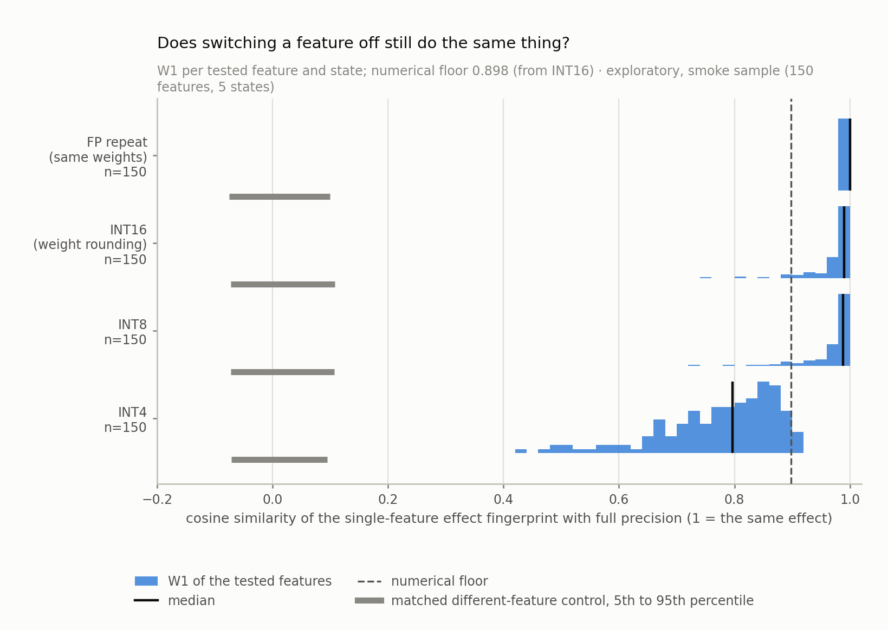
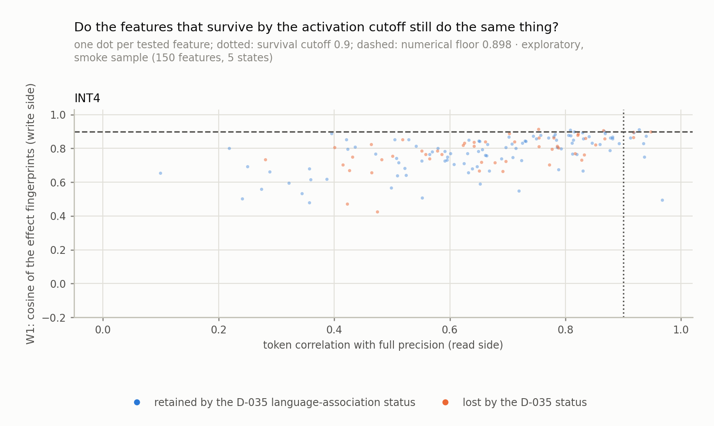
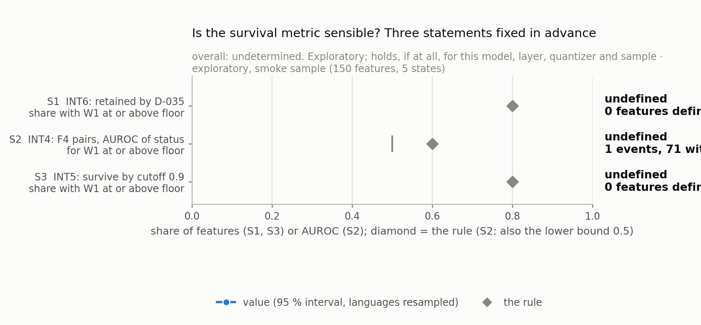
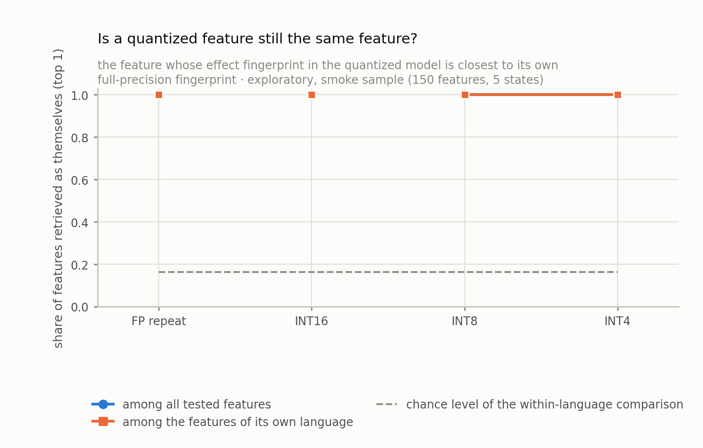
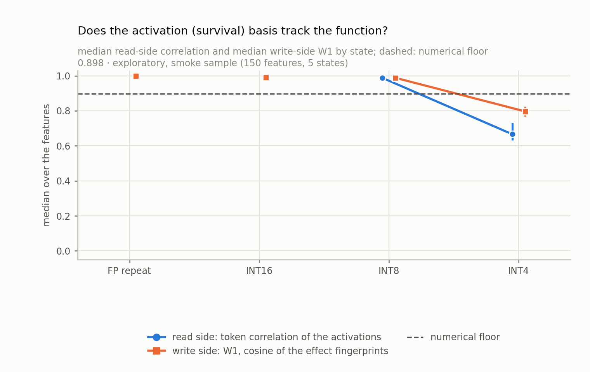
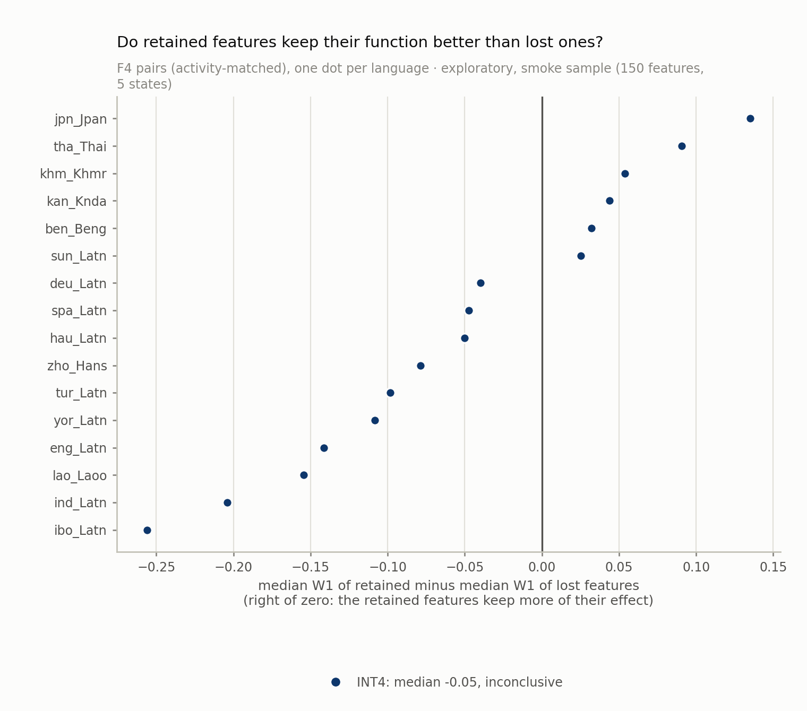

# F5 report: does a feature do the same thing after quantization? (exploratory)

## 1. Instrument and numerical floor

150 sample features, 150 tested on the write side, 0 too rare to test (read side only). Work dtype float32; sham ablation exact: True; logit gates ok: True; run complete: True.

**Numerical floor.** W1 (cosine of the single-feature effect fingerprints) between full precision and the repeat measurement of the same weights (FP-rebatched): median 1.000, 5th percentile 1.000; between full precision and INT16 (weights rounded at the bf16 noise level): median 0.990, 5th percentile 0.898. The numerical floor used below is 0.8983 (the lower of the two, from INT16). INT8, a real quantization, is reported but not part of the floor: median 0.988. Instrument adequate: True.

## 2. Main table (all tested features, by state)

R1 token correlation of the activations with full precision (the survival basis); R2 firing-set Jaccard; R3 scale ratio; W1 cosine of the single-feature effect fingerprints; the share at or above the numerical floor and above the 95th percentile of the matched different-feature control; 'does nothing' = the feature has no effect in the quantized model; top-1 = retrieval of the feature's own identity (within language, chance in brackets). Intervals: 95 %, languages resampled.

| state | tested | R1 median | R1 >= 0.9 | R2 | R3 | W1 median | W1 >= floor | W1 >= control | does nothing | top-1 | within top-1 (chance) |
| --- | --- | --- | --- | --- | --- | --- | --- | --- | --- | --- | --- |
| FP_rebatched | 150 | 1.000 [1.000, 1.000] | 1.000 | 1.000 | 1.000 | 1.000 [1.000, 1.000] | 1.000 [1.000, 1.000] | 1.000 | 0 (0.000) | 1.000 | 1.000 (0.163) |
| INT16 | 150 | 0.995 [0.994, 0.996] | 1.000 | 0.974 | 1.000 | 0.990 [0.983, 0.994] | 0.947 [0.911, 0.983] | 1.000 | 0 (0.000) | 1.000 | 1.000 (0.163) |
| INT4 | 150 | 0.666 [0.631, 0.730] | 0.067 | 0.360 | 0.922 | 0.796 [0.767, 0.824] | 0.033 [0.006, 0.067] | 1.000 | 0 (0.000) | 1.000 | 1.000 (0.163) |
| INT8 | 150 | 0.988 [0.986, 0.990] | 0.993 | 0.943 | 1.000 | 0.988 [0.983, 0.993] | 0.933 [0.875, 0.985] | 1.000 | 0 (0.000) | 1.000 | 1.000 (0.163) |

## 3. Features whose association was lost and retained (F4 subsets), by precision

| group | tested | W1 median | W1 >= floor | R1 median | R1 >= 0.9 |
| --- | --- | --- | --- | --- | --- |
| lost@INT4 | 35 | 0.810 [0.780, 0.827] | 0.029 [0.000, 0.086] | 0.692 | 0.057 |
| retained@INT4 | 37 | 0.728 [0.680, 0.801] | 0.000 [0.000, 0.000] | 0.607 | 0.027 |

## 4. Statements: is the survival metric sensible?

| statement | value | 95 % interval (languages resampled) | defined | verdict |
|---|---|---|---|---|
| S1 INT6, retained by the D-035 status: share with W1 >= floor (rule: >= 0.80) | n/a |  | 0 | undefined |
| S2 INT4, F4 pairs: AUROC of the status for W1 >= floor (rule: >= 0.60, lower bound > 0.5) | 0.239 | [0.204, 0.275] | 1 event, 71 no event | undefined |
| S3 INT5, baseline cutoff (correlation >= 0.9): share with W1 >= floor (rule: >= 0.80) | n/a |  | 0 | undefined |
| descriptive S2c (descriptive, no rule) INT4, F4 pairs: AUROC of W1 for the status retained (0.5 = no relation; below 0.5 the lost features keep more) | 0.319 | [0.211, 0.441] | 37 retained, 35 lost | none |

**Overall: undetermined.** Work dtype float32; sham gate exact True; logit gates ok True; run complete True.

If the three statements hold, they hold for this model, this layer, this quantizer and this sample, nothing more. If they do not hold, the survival label describes the input-side agreement of a coordinate system and no functional claim may be built on it. The study is exploratory: no confirmatory claim is made from it.

## 5. Descriptive hypotheses (H5a to H5c)

- H5a (the median token correlation is at least 0.9 at INT8 and INT6 and lower at INT4 than at INT6): None; medians INT8 0.988, INT4 0.666.
- H5b (the median W1 is below the median token correlation at every quantized precision): False; median W1 INT8 0.988, INT4 0.796; share below the floor INT4 0.967.
- H5c (retained features keep more of their effect than lost ones, paired by language): signs INT4 inconclusive; medians INT4 -0.049.

## 6. Limits

- This study is exploratory: no confirmatory claim is made from it. The rule S1 to S3 was fixed before the first number (Q23); the sample, the contexts and the analysis are one design among several.
- One model (Gemma-2-2B), one layer (the layer-12 residual), one SAE (Gemma Scope, 16,384 features), one quantizer (round-to-nearest per output channel). The ablation is a single-feature zero ablation: a test of the necessity of the feature's term, not of its sufficiency.
- The effect fingerprint is the immediate next-token effect at the ablated positions plus what flows through later positions of the same sentence; the contexts are the dev sentences in which the feature is most active in full precision.
- Features that are active in fewer than 4 candidate dev sentences cannot be tested on the write side; they are counted per language and have read-side values only.
- The D-035 statuses were measured on devtest; the read side uses the 300 frozen evaluation sentences of every language (the same devtest sentences of the frozen loss task).
- The survival verdict is a verdict on a metric, not on the features.

## 7. Figures

- 
- 
- 
- 
- 
- 
